# COSMOSCOPE: System Architecture & Technical Design
**Platform:** COSMOSCOPE — Explore the Changing Infrared Universe  
**NASA Space Apps Challenge 2026** • *SPHEREx All-Sky Spectral Survey*  
**Version:** 2.0.0  

---

## 1. System Overview

COSMOSCOPE is a modern, full-stack astronomical investigation platform engineered to process, visualize, and analyze multi-epoch near-infrared data from NASA's SPHEREx mission alongside archival datasets from 2MASS, WISE, NEOWISE, and Gaia DR3.

```mermaid
graph TD
    subgraph External Astronomical Archives
        IRSA_TAP["NASA/IPAC IRSA TAP\n(spherex.obscore, plane, artifact)"]
        IRSA_IBE["NASA/IPAC IRSA IBE\n(FITS Cutout Service)"]
        GAIA_TAP["Gaia DR3 TAP\n(gaia_dr3_source)"]
        WISE_TAP["AllWISE TAP\n(allwise_p3as_psd)"]
    end

    subgraph Backend Core [FastAPI / Python 3.14]
        API_ROUTER["REST API Routes\n(backend/app/api/routes.py)"]
        FETCHER["FITS Fetcher & Cache Manager\n(backend/app/data_access/fits_fetcher.py)"]
        MEF_PARSER["MEF FITS Parser & WCS\n(backend/app/fits_processing/mef_parser.py)"]
        ASTROMETRY["Astrometry & Motion Tracker\n(backend/app/detection/motion_tracker.py)"]
        SPECTRO["102-Band Spectroscopy Engine\n(backend/app/spectral_analysis/spectroscopy.py)"]
        IMG_PROC["Image Difference & Stacking\n(backend/app/image_analysis/)"]
        ANOMALY["Cosmic Anomaly Intelligence\n(backend/app/detection/anomaly_intelligence.py)"]
        PASSPORT["Evidence Passport PDF Engine\n(backend/app/reports/evidence_passport.py)"]
        CACHE_DIR[("FITS Cache\nbackend/data/cache/fits/")]
        SQLITE_DB[("Embedded Database\nbackend/data/spherex.db")]
    end

    subgraph Frontend Client [React 19 / Vite]
        NAV["Navigation & Mission Control\n(Header, Theme, Health)"]
        TIME_MACHINE["Cosmic Time Machine\n(Timeline, Scrubber, Blinker, Plotly)"]
        SPECTRAL_LAB["Spectral Lab\n(102-Band SED, Absorption Lines)"]
        IMAGE_LAB["Image Analysis Lab\n(Subtraction I2-I1, Stacking)"]
        DISCOVERY["Discovery Engine & Analytics\n(Radar Scores, Candidates)"]
        PASSPORT_UI["Evidence Passport\n(PDF Generation, Dossier)"]
        CITIZEN_UI["Citizen Science Network\n(Review Queue, Classification)"]
    end

    IRSA_TAP --> FETCHER
    IRSA_IBE --> FETCHER
    GAIA_TAP --> API_ROUTER
    WISE_TAP --> API_ROUTER

    FETCHER <--> CACHE_DIR
    FETCHER --> MEF_PARSER
    MEF_PARSER --> API_ROUTER
    ASTROMETRY --> API_ROUTER
    SPECTRO --> API_ROUTER
    IMG_PROC --> API_ROUTER
    ANOMALY --> API_ROUTER
    PASSPORT --> API_ROUTER
    SQLITE_DB <--> API_ROUTER

    API_ROUTER <--> NAV
    API_ROUTER <--> TIME_MACHINE
    API_ROUTER <--> SPECTRAL_LAB
    API_ROUTER <--> IMAGE_LAB
    API_ROUTER <--> DISCOVERY
    API_ROUTER <--> PASSPORT_UI
    API_ROUTER <--> CITIZEN_UI
```



---

## 2. Technology Stack

### Backend
- **Runtime:** Python 3.14 (compatible with 3.10+)
- **API Framework:** FastAPI 0.115+, Uvicorn 0.32+ (Asynchronous ASGI server)
- **Astronomical Data Analysis:** 
  - `astropy` 6.1+ / 7.0+: FITS I/O (`astropy.io.fits`), World Coordinate Systems (`astropy.wcs`), Coordinates (`astropy.coordinates`), Units, and Epoch times (`astropy.time`).
  - `numpy` & `scipy`: Vectorized 2D array manipulation, sub-pixel image interpolation, Gaussian filtering, spatial median calculation, and aperture photometry.
- **Computer Vision & Graphics:** `opencv-python-headless`, `matplotlib`, `Pillow` for FITS image normalization, non-linear stretching (`asinh`, `log`, `sqrt`), and thumbnail generation.
- **Reporting:** `reportlab` 4.2+ for vector PDF generation with embedded astronomical figures and cryptographic checksums.
- **Data Persistence:** SQLite (zero-configuration embedded engine) with optional MySQL support via SQLAlchemy.

### Frontend
- **Framework:** React 19 with Vite 6
- **Routing:** React Router v7
- **Styling:** Tailwind CSS 3.4 with custom deep-space color palette and hardware-accelerated animations.
- **Visualization Engines:**
  - **HTML5 Canvas:** Custom direct-pixel rendering engine for rapid astronomical image blinking and zoom/pan inspection.
  - **Plotly.js (`react-plotly.js`):** Interactive, publication-ready vector charts for Right Ascension vs Time, Declination vs Time, Angular Displacement, Light Curves, and 102-Band Spectral Energy Distributions (SEDs).
  - **Lucide React:** Comprehensive scientific and UI iconography.

---

## 3. Directory & Module Structure

```
d:/SPHEREX/
├── backend/
│   ├── app/
│   │   ├── api/
│   │   │   └── routes.py              # RESTful API endpoints
│   │   ├── data_access/
│   │   │   ├── irsa_client.py         # NASA/IPAC IRSA TAP, Gaia & AllWISE queries
│   │   │   └── fits_fetcher.py        # FITS cutout fetcher, cache & indexer
│   │   ├── detection/
│   │   │   ├── anomaly_intelligence.py# Multi-factor anomaly scoring engine
│   │   │   └── motion_tracker.py      # Proper motion & centroid astrometry
│   │   ├── fits_processing/
│   │   │   ├── mef_parser.py          # 6-HDU MEF parser & WCS transformations
│   │   │   └── coordinates.py         # Sexagesimal & decimal coordinate resolver
│   │   ├── image_analysis/
│   │   │   ├── subtraction.py         # WCS difference imaging (I2 - I1)
│   │   │   └── stacking.py            # Inverse-variance co-addition stacking
│   │   ├── models/
│   │   │   ├── database.py            # SQLite / MySQL connection & session
│   │   │   └── schemas.py             # Pydantic data schemas
│   │   ├── reports/
│   │   │   └── evidence_passport.py   # Vector PDF research dossier generator
│   │   ├── spectral_analysis/
│   │   │   └── spectroscopy.py        # 102-band spectrophotometric extraction
│   │   └── main.py                    # FastAPI application initialization & CORS
│   ├── data/
│   │   ├── cache/fits/                # 43 authentic Level 2 FITS files & cutouts
│   │   └── spherex.db                 # SQLite database for candidate reviews
│   ├── requirements.txt               # Backend dependencies
│   └── tests/
│       ├── test_backend.py            # 16-test comprehensive integration suite
│       └── test_multiepoch_targets.py # Multi-epoch target observation validation
├── frontend/
│   ├── src/
│   │   ├── components/                # Reusable UI controls (Navbar, SearchHeader, Viewer)
│   │   ├── context/                   # Theme & global state providers
│   │   ├── pages/
│   │   │   ├── Home.jsx               # Mission control dashboard
│   │   │   ├── SkyExplorer.jsx        # Interactive sky map & coordinate search
│   │   │   ├── CosmicTimeMachine.jsx  # Multi-epoch time machine & multi-mission view
│   │   │   ├── SpectralLab.jsx        # 102-band spectrophotometric laboratory
│   │   │   ├── ImageAnalysisLab.jsx   # Difference imaging and stacking lab
│   │   │   ├── DiscoveryEngine.jsx    # Anomaly scoring & ranking engine
│   │   │   ├── ScientificAnalytics.jsx# Multi-variable charts & radar breakdown
│   │   │   ├── EvidencePassport.jsx   # Research dossier & PDF export interface
│   │   │   └── CitizenScience.jsx     # Community review queue & voting
│   │   ├── services/
│   │   │   └── api.js                 # Axios API client
│   │   ├── App.jsx                    # Routing configuration
│   │   └── main.jsx                   # React entrypoint
│   ├── package.json                   # Frontend dependencies
│   └── vite.config.js                 # Vite build configuration & proxy
├── docs/                              # API & architectural documentation
├── start.bat                          # One-click Windows full-stack launcher
├── start.ps1                          # PowerShell full-stack launcher
├── .env.example                       # Environment template
└── README.md                          # Project overview & quickstart
```

---

## 4. Key Architectural Patterns & Design Decisions

### 4.1 Resilient Dual-Tier Archive Strategy
- **Primary Tier:** Real-time query to NASA/IPAC IRSA TAP service (`https://irsa.ipac.caltech.edu/TAP/sync`) with non-blocking socket timeouts (1.5s connect, 3.0s read) and 0 HTTP retries.
- **Secondary Tier:** If network connectivity is unavailable, offline, or behind institutional proxies, the engine gracefully transitions to pre-indexed authentic Level 2 Multi-Extension FITS cutouts in `backend/data/cache/fits/`. No fabricated mathematical fallbacks are ever used.

### 4.2 Composite Product Indexing
FITS files are indexed across multiple key dimensions:
1. Exact product key: `f"{obsid}_D{detector}"` (e.g. `2025W17_4B_0145_1_D3`).
2. Observation ID: `obs_id` (e.g. `2025W17_4B_0145_1`).
3. SHA256 URL hash for dynamic cutouts.
4. Astronomical Target identifier (`barnard`, `wise0855`, `rwaur`, `epsindi`, `rdraconis`).

### 4.3 Client-Side Performance Optimizations
- **Canvas-Based High-FPS Blinking:** Frame switching during blink comparison toggles raw image buffers directly on an HTML5 `<canvas>` element without triggering DOM re-renders, enabling smooth 60 FPS transitions.
- **Synchronized Vector Charting:** Plotly graphs maintain synchronized temporal scales with the timeline slider, updating current-epoch markers dynamically.
- **Memory-Efficient Image Transfer:** Images are encoded as base64 PNGs for fast preview rendering, while raw 2D flux matrices (`raw_grid`) are delivered as compact float arrays for client-side pixel hover inspection.
